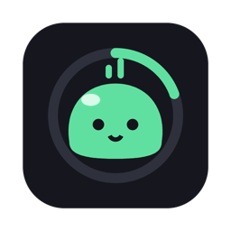
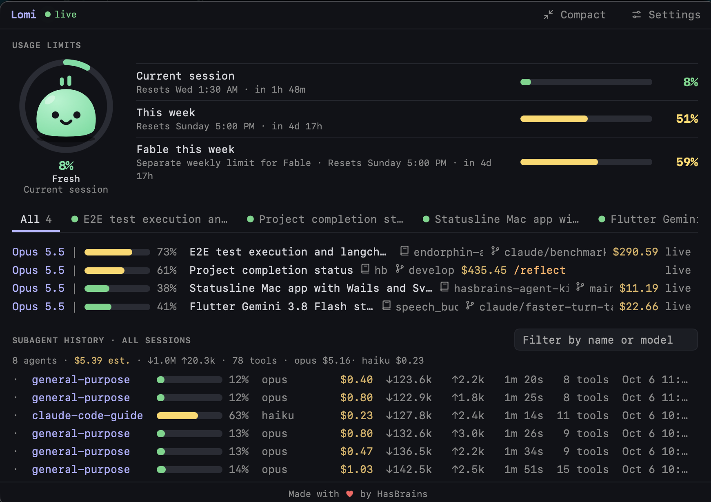
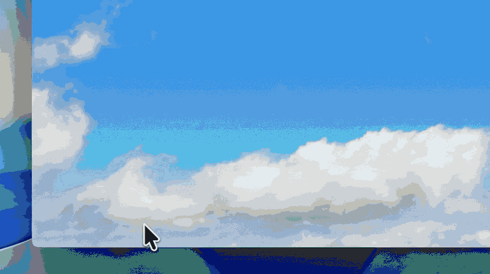

<p align="center"></p>

# Lomi

Lomi shows your Claude Code usage in the macOS menu bar: usage limits, every open session, subagents and cost.



## What you get

- **Usage limits**: current session, this week, and per-model limits such as "Fable this week", each with its reset time.
- **Sessions**: one row and one tab per open Claude Code session, with model, context %, cost, repository and branch.
- **Subagents**: model, context %, cost, tokens, duration and tool calls for each.
- **Monthly budget**: set an amount in dollars and see what this month has cost, what is left, and when it starts again.
- **History**: bar charts of tokens, cost and time in sessions for the last 7, 14, 30 or 90 days.
- **Several Claude accounts**: a switcher at the top shows the limits and sessions of each account.
- **Lomi**: the character in the ring. Its mood goes from Fresh to Out of tokens as you use up the limit.

Lomi reads Claude Code's own files on your Mac. It does not change your sessions.

## Install

You need macOS 12 or later (Apple Silicon or Intel) and [Claude Code](https://claude.com/claude-code).

With [Homebrew](https://brew.sh):

```sh
brew install --cask endorphin-ai/tap/lomi
```

Without Homebrew:

```sh
curl -fsSL https://raw.githubusercontent.com/endorphin-ai/hasbrains-agent-kit/main/app/lomi/install.sh | sh
```

Both put Lomi in `/Applications`. Lomi is signed and notarized by Apple. You can also download `Lomi-macos-universal.zip` from [Releases](https://github.com/endorphin-ai/hasbrains-agent-kit/releases) by hand.

### After you install: add your key

Since version 0.2.0 Lomi needs a license key. A key covers one Mac.

1. Start Lomi: `open /Applications/Lomi.app`. Its face appears in the menu bar. Click it.
2. Get a free key at [keys.endorphinlab.dev](https://keys.endorphinlab.dev/): sign in with your email, on any device, and press **Get my free key**. The key is also sent to your email.
3. Paste the key into Lomi and press **Use this key**.

You can also press **Sign in in the browser** in Lomi; it then takes the key by itself.

To move the key to another Mac, open **Settings** on the old Mac and press **Remove this Mac from the key**. Your keys and the Macs that use them are listed in [your account](https://keys.endorphinlab.dev/account).

### Then: install the bridge

Lomi shows no usage limits until you do this once.

1. Click the Lomi icon, then **Settings**.
2. Click **Install bridge**. If Claude Code has no status line yet, the button is **Set up the status line**.

The bridge is one line in your Claude Code status line script; it gives Lomi live data. A backup of the script is kept.

## Update

```sh
brew upgrade --cask lomi
```

Without Homebrew, run the `curl` install command again.

## Run

```sh
open /Applications/Lomi.app
```

Lomi has no Dock icon. Look for its face in the menu bar and click it.

You can also start it from Spotlight: press Cmd + Space, type "Lomi", press Enter.

### Start at every login

Open Lomi's **Settings** and turn on **Start Lomi when you log in**.

Lomi then starts each time you log in and sits in the menu bar. You can also manage it in System Settings → General → Login Items & Extensions.

### Pin it to the Dock

1. Open the **Applications** folder in Finder.
2. Drag **Lomi** and drop it on the Dock. It stays there.

Click the Dock icon to start Lomi. Because Lomi is a menu-bar app, the Dock icon does not show the "running" dot, and the window still opens from the menu bar icon.

### Move it in the menu bar

Hold **Cmd**, then drag the Lomi icon left or right along the menu bar and drop it where you want it.

## Verify

1. Click the Lomi icon. The window opens under the menu bar.
2. Check that **Settings** shows "Bridge installed". If not, see [Then: install the bridge](#then-install-the-bridge).
3. Send a message in any Claude Code session.
4. In a few seconds the session shows **live**, and the usage limits fill in. If it does not, open a new Claude Code session.



## Go

| To do this | Do this |
|---|---|
| See one session | Click its tab |
| See all sessions and recent subagents | Click **All** |
| Show limits only | Click **Compact** |
| See the last days as charts | Click **History** |
| See another Claude account | Choose it in the list at the top |
| Close the window | Press Escape or click elsewhere |
| Quit | Right-click the menu bar icon |

The number beside the menu bar icon is the used % of your session limit.

## Change

Everything is in **Settings**:

- **Your key**: the key of this Mac, with **Remove this Mac from the key**.
- **Monthly budget**: turn it on and set the amount. The cost is an estimate at API prices; on a Claude subscription it is not what you pay.
- **History**: keep 30, 60 or 90 days, or clear it.
- **Claude folders**: add the folder of another Claude account. Lomi reads who is signed in from Claude's settings file and never reads that account's login.
- **Per-model weekly limits**: turn "Fable this week" on or off. Read the note there first; this option uses your Claude login.
- **Panels**: show or hide limits, sessions, command run and subagents.
- **Display**: bar style, number of subagent rows, refresh interval, the character, animations, start at login.
- **Git**: show or hide repository, branch and worktree.
- **Prices**: USD per 1M tokens for each model. Lomi uses them to estimate subagent cost.
- **Thresholds**: when a bar turns yellow or red.

## Remove

```sh
curl -fsSL https://raw.githubusercontent.com/endorphin-ai/hasbrains-agent-kit/main/app/lomi/uninstall.sh | sh
```

This quits Lomi, deletes the app, its settings and saved data, and takes the bridge line out of your status line script. If Lomi created your status line, that small script stays; it only shows the model name.

If you plan to use your key on another Mac, press **Remove this Mac from the key** in Settings before you remove Lomi.

By hand: quit Lomi (right-click its menu bar icon), then drag `Lomi.app` from the Applications folder to the Trash.

## What is new

**0.2.0, 13 October 2026**

- License keys: Lomi needs a key. Paste one, or sign in in the browser.
- Monthly budget, with a row for what the month has cost.
- History: tokens, cost and time in sessions by day, for up to 90 days.
- Several Claude accounts, with a switcher at the top.
- The strip of session tabs scrolls with a mouse wheel and has a scrollbar.
- Lomi is now made by Endorphin Lab.

**0.1.4, 7 October 2026**

- A switch in Settings starts Lomi when you log in.

[lomi.software](https://lomi.software/) · Made with ♥ by [Endorphin Lab](https://endorphinailab.com/).
